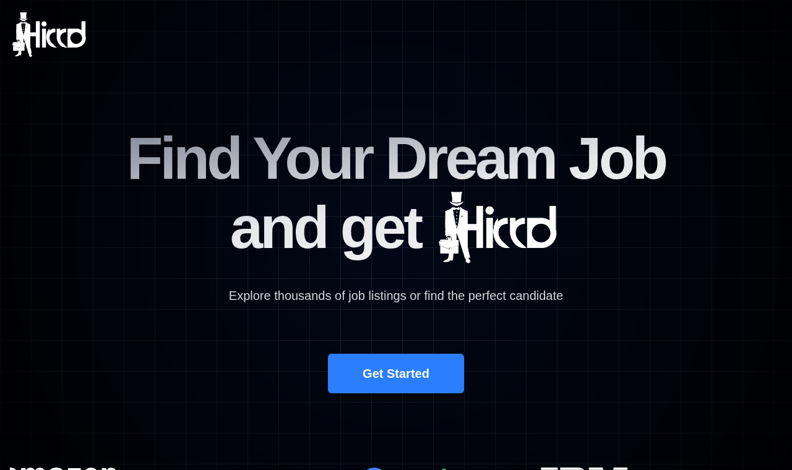

# Hirrd : portail d'emploi React, Clerk et Supabase

[](https://github.com/blcoussama/REACT-SUPABASE-CLERK/actions/workflows/ci.yml)

Portail d'emploi où des recruteurs publient des offres et des candidats postulent avec leur CV. L'authentification passe par Clerk, les données et les fichiers par Supabase, et toutes les règles d'accès sont appliquées par PostgreSQL (Row Level Security).



*Page d'accueil lancée en local. Les captures des autres pages sont à venir : elles demandent une application Clerk et un projet Supabase configurés.*

## Fonctionnalités

- **Inscription / connexion** avec Clerk, puis choix unique du rôle : candidat ou recruteur.
- **Candidat** : parcourir les offres (recherche par titre, filtres par ville et par entreprise), les enregistrer en favoris, postuler avec un CV (PDF ou Word, 5 Mo maximum), suivre le statut de ses candidatures.
- **Recruteur** : publier une offre (exigences en Markdown), créer une entreprise avec son logo, ouvrir ou fermer le recrutement, consulter les candidatures de ses offres, télécharger les CV, changer le statut d'une candidature (applied, interviewing, hired, rejected), supprimer ses offres.

## Stack

- **Front** : React 19, Vite 8, React Router 7, Tailwind CSS 4, shadcn/ui (Radix UI), react-hook-form et zod, @uiw/react-md-editor et rehype-sanitize
- **Authentification** : Clerk (`@clerk/react`, Core 3)
- **Données** : Supabase (PostgreSQL, RLS, Storage, Edge Functions), intégration Clerk « third-party auth »
- **Tests** : Vitest + Testing Library, pgTAP sur l'image Docker `supabase/postgres`
- **CI** : GitHub Actions

## Architecture et modèle de sécurité

```
Navigateur ──(jeton de session Clerk)──> Supabase REST / Storage ──> PostgreSQL + RLS
     │                                                                  ▲
     └──(jeton Clerk)──> Edge Function set-role ──(clé secrète)──> API Clerk (public metadata)
```

1. Le front crée **un seul** client Supabase qui envoie le jeton de session Clerk (`accessToken: () => getToken()`). Supabase vérifie ce jeton avec les clés publiques de Clerk : aucun secret partagé ni « JWT template ».
2. Le **rôle** est choisi une seule fois via l'Edge Function `set-role`, qui vérifie le jeton et écrit le rôle dans les métadonnées **publiques** Clerk (que le navigateur ne peut pas modifier, contrairement à `unsafeMetadata`).
3. Le jeton de session contient ce rôle (claim `user_role`). Les politiques RLS s'appuient sur `auth.jwt() ->> 'sub'` (identifiant Clerk) et `auth.jwt() ->> 'user_role'`.

| Données | Lecture | Écriture |
|---|---|---|
| Offres (`jobs`) | tout utilisateur connecté | création par un recruteur pour lui-même ; modification et suppression par le recruteur propriétaire |
| Entreprises (`companies`) | tout utilisateur connecté | création par un recruteur |
| Candidatures (`applications`) | le candidat concerné et le recruteur propriétaire de l'offre | création par un candidat, pour lui-même, sur une offre ouverte, statut `applied` ; seul le statut est modifiable, par le recruteur de l'offre |
| Favoris (`saved_jobs`) | leur propriétaire | leur propriétaire |
| CV (bucket `resumes`, **privé**) | le candidat et le recruteur de l'offre, via une URL signée valable 60 s | le candidat, dans son propre dossier |
| Logos (bucket `company-logo`, public) | tout le monde | les recruteurs, dans leur propre dossier |

Un visiteur non connecté (clé `anon`) n'a accès à aucune table.

```
src/
  api/          requêtes Supabase (ApiJobs, ApiApplications, ApiCompanies, ApiUsers)
  components/   composants (shadcn/ui dans components/ui), SafeMarkdown
  hooks/        useFetch, useRole
  pages/        Landing, OnBoarding, JobListing, Job, PostJob, MyJobs, SavedJobs
  utils/        client Supabase authentifié par Clerk
supabase/
  migrations/   schéma, privilèges, politiques RLS, buckets et politiques Storage
  functions/    Edge Function set-role (handler.js testable + index.ts Deno)
  tests/        tests pgTAP des politiques RLS + exécuteur
```

## Configuration pas à pas

Prérequis : Node.js 22.12 ou plus récent, un compte Clerk, un compte Supabase et la [CLI Supabase](https://supabase.com/docs/guides/local-development/cli/getting-started) (`npx supabase` suffit).

### 1. Clerk

1. Créer une application dans le [Clerk Dashboard](https://dashboard.clerk.com) et noter la **Publishable key** (`pk_test_…`) et la **Secret key** (`sk_test_…`) dans *Configure > API keys*.
2. *Configure > Sessions > Customize session token* : ajouter le claim du rôle lu par la RLS :
   ```json
   { "user_role": "{{user.public_metadata.role}}" }
   ```
3. Activer l'intégration Supabase depuis sa page de configuration dans le Clerk Dashboard. Elle ajoute le claim `role: "authenticated"` aux jetons et affiche le **domaine Clerk** (ex. `xxx.clerk.accounts.dev`) à copier.

### 2. Supabase

1. Créer un projet, puis dans *Authentication > Sign In / Providers*, ajouter le fournisseur tiers **Clerk** et coller le domaine Clerk.
2. Appliquer la migration (projet neuf) :
   ```bash
   npx supabase login
   npx supabase link --project-ref <référence-du-projet>
   npx supabase db push
   ```
   (ou copier `supabase/migrations/20261023000000_schema_and_rls.sql` dans le *SQL Editor*).
3. Déployer l'Edge Function et lui donner ses secrets :
   ```bash
   npx supabase functions deploy set-role --no-verify-jwt
   npx supabase secrets set CLERK_SECRET_KEY=sk_test_... ALLOWED_ORIGINS=http://localhost:5173
   ```
   `--no-verify-jwt` (et `verify_jwt = false` dans `supabase/config.toml`) : c'est la fonction qui vérifie elle-même le jeton Clerk (signature, expiration et origine `azp`).

### 3. Front

Créer `.env.local` à la racine (jamais versionné) :

| Variable | Description |
|---|---|
| `VITE_CLERK_PUBLISHABLE_KEY` | Publishable key Clerk |
| `VITE_SUPABASE_URL` | URL du projet Supabase (*Project Settings > API*) |
| `VITE_SUPABASE_ANON_KEY` | Clé `anon` / publishable du projet |

Ces trois valeurs sont publiques. La clé secrète Clerk ne va que dans les secrets de l'Edge Function.

```bash
npm install
npm run dev        # http://localhost:5173
npm run build      # build de production dans dist/
```

En développement local complet (`npx supabase start`), remplacer le domaine Clerk dans la section `[auth.third_party.clerk]` de `supabase/config.toml`.

## Tests

```bash
npm test           # 21 tests Vitest
npm run lint
```

- **Fonctions d'API** (client Supabase simulé) : statut modifié sur l'id de la candidature et pas sur l'offre, retrait d'un favori limité à l'utilisateur, CV envoyé dans le dossier du candidat du bucket privé et stocké par chemin, fichier supprimé si l'insertion est refusée, URL signée de 60 s, rôle demandé à l'Edge Function.
- **SafeMarkdown** : une charge XSS (`<script>`, `onerror`, `<iframe>`, lien `javascript:`) est neutralisée et la mise en forme Markdown conservée.
- **Edge Function `set-role`** : jeton absent ou forgé (401), rôle inconnu ou champs en trop (400), rôle déjà choisi (409), CORS limité aux origines autorisées.

### Tests des politiques RLS (pgTAP)

```bash
docker run -d --name supabase-db-test -e POSTGRES_PASSWORD=postgres -p 55460:5432 supabase/postgres:17.6.1.178
npm run test:db    # 50 tests pgTAP ; DATABASE_URL pour une autre base
docker rm -f supabase-db-test
```

`npm run test:db` applique la migration puis `supabase/tests/rls.test.sql` dans une transaction annulée à la fin. Les utilisateurs sont simulés comme le fait PostgREST (`role authenticated` + `request.jwt.claims`). Les tests couvrent : accès anonyme refusé, utilisateur sans rôle serveur (par exemple un rôle écrit dans `unsafeMetadata`), candidat qui tente de publier une offre, de postuler à la place d'un autre, de joindre le CV d'un autre, de choisir son statut, de lire les CV ou candidatures des autres ; recruteur qui tente de modifier, fermer ou supprimer l'offre d'un autre, de lire ses candidatures ou CV, de modifier autre chose que le statut ; favoris privés ; buckets et types de fichiers.

L'image `supabase/postgres` ne contient pas les objets créés par les services Auth et Storage : `supabase/tests/00_supabase_shim.sql` recrée, **pour les tests uniquement**, `auth.jwt()` et les tables `storage.buckets` / `storage.objects` avec les mêmes définitions que Supabase.

La CI GitHub Actions exécute le lint, les tests Vitest, le build, `npm audit --omit=dev`, un `deno check` de l'Edge Function et les tests pgTAP sur un conteneur `supabase/postgres`.

## Limites connues

- Projet non déployé ; captures des pages connectées à venir.
- Le rôle ne se choisit qu'une fois : pour le changer, modifier `public_metadata.role` dans le Clerk Dashboard.
- Supprimer une offre supprime ses candidatures, mais pas les fichiers CV correspondants dans Storage.
- Le bucket des logos est public (les logos n'ont rien de confidentiel), les URL de logo sont limitées à `http(s)://`.
- Pas de pagination des offres.
- La migration crée un schéma neuf. Sur un ancien projet, les CV déjà enregistrés sous forme d'URL publique ne sont plus lisibles une fois le bucket privé : il faut les déplacer dans `<id-utilisateur>/…` et stocker leur chemin.
- Les tests pgTAP vérifient les politiques Storage au niveau SQL ; l'API Storage elle-même (génération réelle des URL signées) n'est pas exécutée dans les tests.

## Origine du projet

Projet d'apprentissage réalisé en suivant un tutoriel YouTube (portail d'emploi « Hirrd »), que j'avais adapté au Maroc (villes Tanger, Casablanca et Rabat).

### Ce que j'ai ajouté / corrigé (remise à niveau 2026)

- **Schéma et politiques RLS versionnés** (aucune politique n'était dans le dépôt) et testés par 50 tests pgTAP.
- **Rôle côté serveur** : il était écrit par le navigateur dans `unsafeMetadata`, modifiable par n'importe qui, et les contrôles « recruteur » n'existaient que côté client. Il passe maintenant par une Edge Function et par les métadonnées publiques Clerk, et la RLS s'appuie dessus.
- **Candidatures** : la page d'une offre demandait toutes ses candidatures sans qu'aucune politique versionnée ne les filtre ; elles ne sont plus visibles que par le candidat et le recruteur de l'offre.
- **CV** : ils étaient dans un bucket public sous des noms devinables ; bucket privé, chemins aléatoires dans le dossier du candidat, URL signées de 60 s.
- **XSS stocké** via le Markdown des offres (HTML brut accepté) : rendu nettoyé avec rehype-sanitize.
- **Bugs de filtres** : changer le statut d'une candidature modifiait toutes les candidatures de l'offre (puis relançait la requête sans statut) ; le retrait d'un favori n'était filtré que sur l'offre (il visait les favoris de tous les utilisateurs) et ne s'exécutait jamais, l'état « déjà enregistré » n'étant pas transmis.
- **Intégration Clerk → Supabase** : « JWT template » déprécié remplacé par la « third-party auth » ; `@clerk/clerk-react` (déprécié, faille de contournement d'autorisation signalée par `npm audit`) remplacé par `@clerk/react`.
- Build qui échouait sous Linux (casse d'un import), ESLint (50 erreurs ramenées à 0), dépendances à jour (React 19, Vite 8, Tailwind 4) avec `npm audit` à 0 vulnérabilité, tests Vitest, CI, README.
